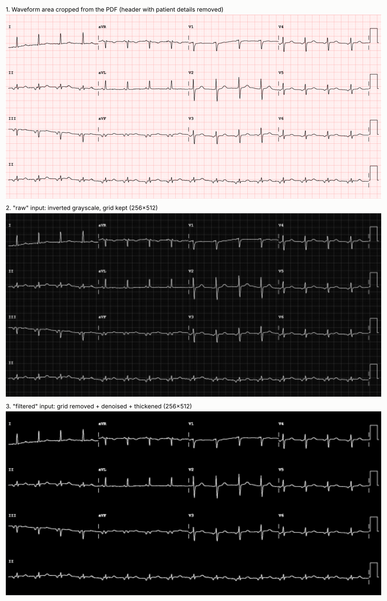
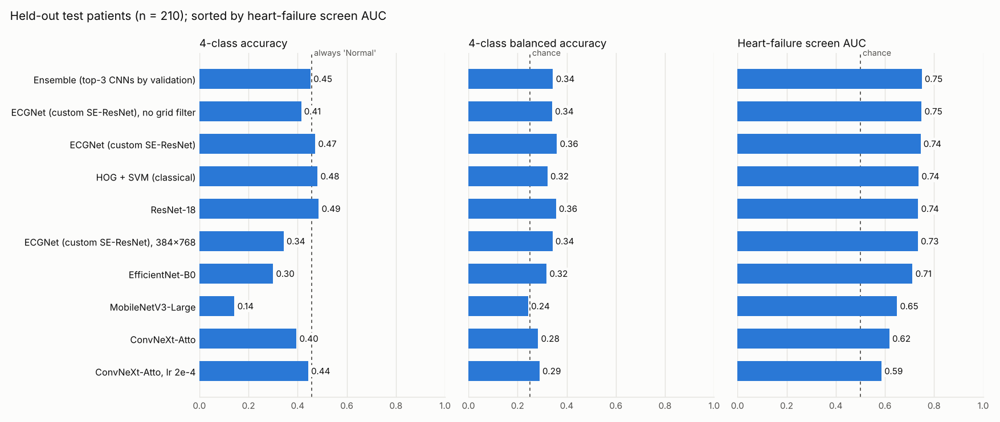
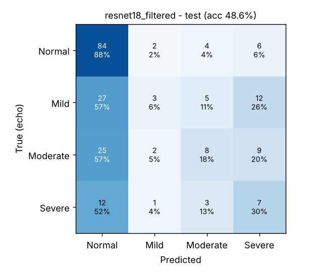
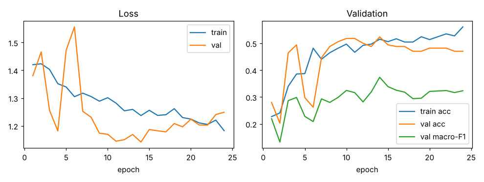
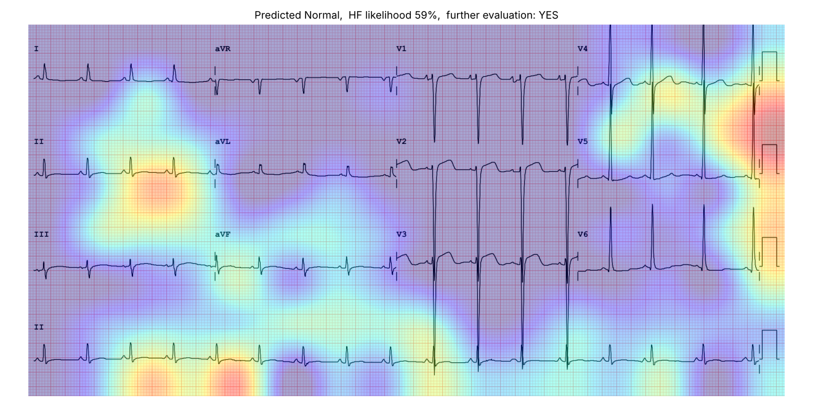

# ECG image → LVEF category & heart-failure screening (12-lead, CNN)

A deep-learning pipeline that takes a **12-lead ECG image** (the PDF printout from the
ECG machine, or a PNG/JPG of it) and predicts:

1. the **Left-Ventricular Ejection Fraction (LVEF) category** – **Normal / Mild / Moderate / Severe**, and
2. the **likelihood of heart failure (reduced EF)** with a simple **YES / NO – needs further cardiac evaluation** decision.

It is meant as an automated, non-invasive *preliminary screening* aid that flags
patients who should get an echocardiogram / cardiology review. It is **not** a
diagnostic device.

```
$ python -m ecg_ef.predict "LV_ECG_Dataset_2020/Severe/EK__[20200914112110]_….pdf"
model: ResNet-18  (1 network(s)); category by argmax decoding; further-evaluation threshold: HF likelihood >= 38%

  LVEF category           : Normal      probabilities: Normal 41%  Mild 26%  Moderate 15%  Severe 17%
  Heart-failure likelihood: 59%
  Further evaluation      : YES - borderline: most probable class is Normal but heart-failure likelihood is above the screening threshold; consider echo
```
*(Real output for a held-out test ECG whose echo showed severely reduced EF: the
screening decision is correct, the 4-class category is not – see Results.)*

> **Bottom line of the experiments (details in §4):** on held-out patients the models
> separate *reduced* from *normal* EF with **AUC ≈ 0.75** (95 % CI ≈ 0.68–0.81) – a
> useful but modest screening signal. The **4-class category is not reliable yet**:
> accuracy is no better than always answering "Normal", and Mild/Moderate are rarely
> recognised. With 669 training images and no pretrained weights, no CNN was clearly
> better than a classical HOG + SVM baseline.

---

## 1. Dataset

`LV_ECG_Dataset_<year>/<class>/*.pdf` – one 12-lead ECG per PDF (25 mm/s, 10 mm/mV,
3×4 layout + lead-II rhythm strip). The folder name is the label, derived from the
patient's echocardiogram (EF by Teichholz) in `ECG_ECHO/ecg_echo_matching.ipynb`:

| Class    | EF definition (ASE)                         | 2020 | 2021 | 2022 | 2024 | Total |
|----------|---------------------------------------------|-----:|-----:|-----:|-----:|------:|
| Normal   | EF > 52 % (male) / ≥ 54 % (female)          | 120  | 120  | 120  | 120  | 480 |
| Mild     | EF 41–52 % (male) / 41–53 % (female)        | 48   | 74   | 42   | 68   | 232 |
| Moderate | EF 31–40 %                                  | 36   | 69   | 43   | 73   | 221 |
| Severe   | EF < 31 %                                   | 28   | 31   | 21   | 34   | 114 |
|          |                                             | 232  | 294  | 226  | 295  | **1,047** |

**Train / validation / test split – by patient.** 993 unique patients; 48 have more
than one ECG (32 of them in different classes). A random image split would put the
same person in train and test and inflate accuracy, so the split is
`StratifiedGroupKFold` grouped on the (hashed) patient name and stratified by class:

| split | Normal | Mild | Moderate | Severe | total |
|-------|------:|-----:|--------:|------:|------:|
| train | 307 | 148 | 141 | 73 | 669 |
| val   | 77  | 37  | 36  | 18 | 168 |
| test  | 96  | 47  | 44  | 23 | 210 |

The split is saved in [`results/split.csv`](results/split.csv) (ECG id + label only).

## 2. Image preprocessing & filters (`ecg_ef/preprocess.py`)



| Step | What / why |
|------|------------|
| **Render** | The PDFs are vector graphics; the page is rasterised at 1 px/pt. All 1,047 files share the same layout (grid at y = 547–1697 pt), so one crop works for all. |
| **Crop to waveforms** | Keeps only the 12-lead area. This **removes the header** (patient name/age/sex *and* the machine's printed interpretation such as "LBBB" or "anterior infarct"), so the network must learn from the waveforms themselves and cannot read the answer from text. |
| **Grid-removal filter** | `darkness = 255 − max(R,G,B)` (HSV value). Pink/red grid lines have a high value, the black trace a low one, so the grid disappears. Works for any coloured grid, so also for scans/photos. |
| **Otsu threshold** | Adaptive (clamped) binarisation of the trace. |
| **Denoise** | Removes connected components < 6 px (scanner speckle, grid crossings) without eroding thin trace lines (a median/opening filter would). |
| **Thicken** | Scale-aware dilation so 1-px lines survive down-sampling. |
| **Resize** | Area (anti-aliased) interpolation to 512×1024 cache → 256×512 network input. |

A **"raw"** variant (inverted grayscale, grid kept, no filtering) is also built so the
benefit of the filters can be measured.

**Augmentation (training only, `ecg_ef/data.py`)** – small rotation (±2°), independent
time/amplitude scaling (±6 % / ±10 %, i.e. paper-speed and gain differences),
translation (±3 %) and random erasing of a narrow time segment (lead-off artefact).
**No flips**: a horizontal flip reverses time and a vertical flip inverts every
lead's polarity – both change the diagnosis.

## 3. Models compared

| Model | Type | Params |
|-------|------|------:|
| **HOG + SVM** | classical baseline: histogram-of-oriented-gradients features → PCA(150) → RBF-SVM | – |
| **ECGNet** (`ecg_ef/models.py`) | custom residual CNN for ECGs: 7×7 stem, 4 stages of residual blocks with **time-elongated 3×5 kernels** and **squeeze-excitation channel attention**, **global average + max pooling** head (max-pool keeps strong local evidence such as one abnormal QRS), dropout | 6.3 M |
| **ResNet-18** | standard residual CNN (timm) | 11.2 M |
| **EfficientNet-B0** | compound-scaled MBConv + SE (timm) | 4.0 M |
| **ConvNeXt-Atto** | modern "ConvNet for the 2020s" design (timm) | 3.4 M |
| **MobileNetV3-Large** | lightweight inverted-residual CNN (timm) | 4.2 M |
| ECGNet on **raw** images | same network, no grid filter – *filter ablation* | 6.3 M |
| ECGNet at **384×768** | same network, 2.25× more pixels – *resolution ablation* | 6.3 M |
| **Ensemble** | soft voting: mean of the class probabilities of the 3 CNNs with the best *validation* score (`ecg_ef/ensemble.py`) | – |

All CNNs take a 1-channel 256×512 image (unless stated) and are trained **from scratch**
(this environment had no internet access to download ImageNet weights; use
`--pretrained` where you have it).

**Training** (`ecg_ef/train.py`): AdamW (lr 1e-3, wd 0.05), 2-epoch warm-up + cosine
schedule, batch 16, ≤ 30 epochs, early stopping (patience 10).
Class-weighted cross-entropy (inverse class frequency – Severe is only 11 % of the data)
with label smoothing 0.05. An **exponential moving average (EMA) of the weights** is
evaluated and saved – with ~670 training images the raw weights swing a lot from epoch
to epoch. The checkpoint is chosen on the **validation** set by
`score = mean(macro-F1, quadratic-weighted κ, heart-failure AUC)`, from epoch 8 on (so a
lucky early epoch can't win). The test set is used once, at the end.

### Decision rules

* **4-class category.** Two rules are reported:
  *argmax* (most probable class) and *ordinal decoding*: the expected severity
  `s = Σ k·P(k)` (Normal = 0 … Severe = 3) is cut into four bands with three cut-points
  fitted on the validation set (macro-F1). Argmax almost never outputs Mild or Moderate –
  their probability is shared with the neighbouring classes – whereas the ordinal rule
  uses the fact that the classes are ordered. `predict.py` uses ordinal decoding.
* **Heart-failure likelihood** = `P(Mild) + P(Moderate) + P(Severe)` = `1 − P(Normal)`,
  i.e. the probability that EF is reduced (≤ 52–53 %).
  **Further evaluation = YES** when the likelihood is above a threshold chosen on the
  validation set to give **≥ 80 % sensitivity** – for screening, missing a patient with
  low EF is worse than one extra echo.

## 4. Results

Held-out **test set: 210 ECGs from 199 patients** never seen during training or model
selection. Full numbers: [`results/comparison.md`](results/comparison.md) /
[`.csv`](results/comparison.csv); per-model metrics, training curves, confusion matrices
and predictions in `results/<model>/`.



*Dashed lines: what a model with no information scores (always "Normal" = 45.7 %
accuracy, because 96 / 210 test ECGs are Normal; 0.25 balanced accuracy; 0.5 AUC).*

### 4.1 Heart-failure screening – reduced EF (Mild/Moderate/Severe) vs Normal

| Model | AUC (95 % CI) | Sensitivity | Specificity | EF ≤ 40 % AUC | Params (M) | CPU train (min) |
|-------|---------------|-----:|-----:|-----:|-----:|-----:|
| Ensemble (top-3 CNNs by validation) | **0.750** (0.68–0.81) | 0.71 | 0.59 | 0.705 | – | – |
| ECGNet, no grid filter | **0.749** (0.68–0.81) | 0.75 | 0.57 | 0.694 | 6.3 | 20.7 |
| ECGNet | **0.745** (0.68–0.81) | 0.71 | 0.62 | 0.703 | 6.3 | 21.0 |
| HOG + SVM (classical) | **0.737** (0.67–0.80) | 0.82 | 0.47 | 0.725 | – | 1.2 |
| **ResNet-18** (selected) | **0.735** (0.66–0.80) | 0.72 | 0.61 | 0.697 | 11.2 | 23.5 |
| ECGNet, 384×768 | **0.734** (0.66–0.80) | 0.72 | 0.54 | 0.699 | 6.3 | 49.4 |
| EfficientNet-B0 | **0.712** (0.64–0.78) | 0.71 | 0.65 | 0.659 | 4.0 | 35.5 |
| MobileNetV3-Large | **0.649** (0.57–0.72) | 0.82 | 0.39 | 0.616 | 4.2 | 12.0 |
| ConvNeXt-Atto | **0.618** (0.54–0.70) | 0.73 | 0.35 | 0.627 | 3.4 | 18.5 |
| ConvNeXt-Atto, lr 2e-4 | **0.586** (0.51–0.66) | 0.81 | 0.26 | 0.540 | 3.4 | 16.2 |

Sensitivity/specificity are at each model's threshold chosen on the validation set for
≥ 80 % sensitivity; on the test set sensitivity lands at 71–82 %.

### 4.2 Four-class LVEF category (Normal / Mild / Moderate / Severe)

| Model | Accuracy (95 % CI) | Balanced acc. | Macro-F1 | QWK | Balanced acc. *(ordinal)* | Macro-F1 *(ordinal)* |
|-------|----------|-----:|-----:|-----:|-----:|-----:|
| Ensemble (top-3 CNNs by validation) | 0.452 (0.38–0.52) | 0.344 | 0.262 | 0.377 | 0.319 | 0.314 |
| ECGNet, no grid filter | 0.414 (0.35–0.48) | 0.340 | 0.276 | 0.342 | 0.326 | 0.326 |
| ECGNet | 0.471 (0.41–0.53) | **0.360** | 0.262 | **0.389** | 0.330 | 0.320 |
| HOG + SVM (classical) | 0.481 (0.41–0.55) | 0.322 | 0.283 | 0.229 | **0.413** | **0.406** |
| **ResNet-18** (selected) | **0.486** (0.42–0.55) | 0.356 | **0.323** | 0.290 | 0.322 | 0.315 |
| ECGNet, 384×768 | 0.343 (0.28–0.41) | 0.342 | 0.229 | 0.237 | 0.366 | 0.360 |
| EfficientNet-B0 | 0.300 (0.24–0.36) | 0.318 | 0.236 | 0.130 | 0.333 | 0.332 |
| MobileNetV3-Large | 0.143 (0.10–0.19) | 0.243 | 0.111 | 0.062 | 0.304 | 0.304 |
| ConvNeXt-Atto | 0.395 (0.33–0.46) | 0.283 | 0.262 | 0.249 | 0.310 | 0.301 |
| ConvNeXt-Atto, lr 2e-4 | 0.443 (0.37–0.51) | 0.289 | 0.262 | 0.089 | 0.288 | 0.279 |
| *always "Normal"* | *0.457* | *0.250* | *0.157* | *0* | | |

QWK = quadratic-weighted Cohen's κ (penalises Normal→Severe errors more than
Normal→Mild).

### 4.3 What the comparison shows

1. **Screening works modestly; the 4-class category does not (yet).** The best models
   separate reduced from normal EF with AUC ≈ 0.75. For the four categories, accuracy is
   at the "always Normal" level and balanced accuracy is only 0.34–0.36 (chance 0.25):
   the models learned "normal vs clearly abnormal", not the fine EF bands.
2. **No model is clearly best.** The top six are within 0.016 AUC of each other, with
   overlapping 95 % CIs of ±0.07, and the classical **HOG + SVM is as good as the CNNs**.
   With 669 training images and no pretraining, the deep networks don't have enough data
   to beat hand-crafted edge features.
3. **Large ImageNet architectures trained from scratch did worst.** EfficientNet-B0 and
   MobileNetV3 trained unstably. ConvNeXt never left chance-level training loss in 30
   epochs, at either learning rate (its residual "layer scale" starts at 1e-6 and needs
   much longer schedules or pretrained weights). The compact ResNet-style models
   (ResNet-18, the custom ECGNet) were the most reliable.
4. **Grid filter:** on these clean, digitally generated PDFs, removing the grid improved
   4-class accuracy (0.47 vs 0.41) and QWK (0.39 vs 0.34) but not the screening AUC. The
   grid is identical in every file, so a CNN can learn to ignore it. Expect the filter
   to matter more for scanned or photographed ECGs with varying grids.
5. **Higher resolution did not help** (384×768: AUC 0.734 vs 0.745). The bottleneck is
   data and labels, not pixels.
6. **Ordinal decoding** raises Mild/Moderate recall (ECGNet Moderate recall 0.02 → 0.41)
   but drops Severe recall from 0.30–0.52 to 0.04 for the CNNs, so it is **off by default**
   (`--decoding ordinal` to use it).
7. **Ensembling** the three best CNNs gave the highest AUC (0.750), but the gain is
   within noise.

### 4.4 Selected model – ResNet-18

`compare.py` picks the CNN with the best **validation** score:
[`results/best_model.json`](results/best_model.json) → `models/resnet18_filtered.pt`.

| Test (n = 210) | |
|---|---|
| Further evaluation = YES if HF likelihood ≥ 38 % | sensitivity **72 %**, specificity **61 %**, PPV 69 %, NPV 65 % (TP 82, FN 32, FP 37, TN 59) |
| 4-class (argmax) | accuracy 48.6 %; recall Normal 88 %, Mild 6 %, Moderate 18 %, Severe 30 % |
| Accuracy by year | 2020: 55 %, 2021: 42 %, 2022: 61 %, 2024: 41 % |

 

**Grad-CAM** (`--gradcam`) for the Severe test ECG in the example at the top:



The heat-map is coarse (8×16 cells). It highlights V4–V5 and lead II, but also the
**calibration pulses** at the right edge. Those carry no cardiac information, so this is
a warning that the model may be partly using non-physiological cues.

## 5. Limitations and how to improve

* **Small dataset, trained from scratch.** This is the biggest lever. Published AI-ECG
  low-EF models used tens of thousands of ECG–echo pairs; e.g. Attia et al.,
  *Nature Medicine* 2019, trained on ~36 k pairs and reached AUC 0.93 for EF ≤ 35 %.
  Here: 669 training ECGs. Next steps:
  `python -m ecg_ef.train --model resnet18 --pretrained` (ImageNet weights, which this
  environment could not download) and more ECGs.
* **Label noise.** Labels come from matching ECG and echo records by patient name
  (fuzzy matching, `ECG_ECHO/`). The time gap between ECG and echo is unknown, and
  Teichholz EF (M-mode) is less accurate than Simpson's biplane, especially with regional
  wall-motion abnormalities.
* **Sex-specific Normal/Mild cut-off** (52 vs 54 %). The model only sees the waveforms;
  adding sex (printed in the header) as an input should help near that boundary.
* **Small test set** → wide confidence intervals (about ±0.07 AUC). Use k-fold
  cross-validation for tighter estimates.
* **Signal extraction.** The PDFs are vector graphics, so the exact voltage samples of
  every lead can be read from the drawing paths and fed to a 1-D CNN. That is likely
  more data-efficient than images.
* **Single centre / single ECG machine**, so external validation is needed.
* **Not a medical device.** A NO does not rule out heart failure, and a YES means
  "get an echocardiogram", not a diagnosis.

## 6. How to run

```bash
pip install -r requirements.txt

python -m ecg_ef.preprocess          # render + filter all PDFs, build patient-grouped split (~1 min)
./run_experiments.sh                 # baseline + all CNNs + comparison table (hours on CPU, minutes on GPU)

# or individually
python -m ecg_ef.baseline
python -m ecg_ef.train --model ecgnet --variant filtered
python -m ecg_ef.train --model resnet18 --pretrained      # ImageNet weights (needs internet)
python -m ecg_ef.ensemble                                # top-3 CNNs by validation score
python -m ecg_ef.compare                                 # results/comparison.{md,csv,png}, picks best model

# predict new ECGs (PDF, PNG or JPG; files or folders) with the selected model
python -m ecg_ef.predict path/to/ecg.pdf
python -m ecg_ef.predict new_ecgs/ --csv predictions.csv --gradcam heatmaps/
python -m ecg_ef.predict ecg.pdf --model models/ecgnet_filtered.pt      # a specific model
python -m ecg_ef.predict ecg.pdf --decoding ordinal                     # ordinal 4-class rule
```

Model names for `--model`: `ecgnet`, `resnet18`, `resnet34`, `efficientnet_b0`,
`densenet121`, `mobilenetv3`, `convnext_atto`. The trained checkpoints of the selected
ResNet-18 and the custom ECGNet are included in `models/`; the others are re-created by
`./run_experiments.sh`.

`--gradcam` saves a heat-map over the ECG showing which leads / beats drove the
prediction (Grad-CAM on the last convolutional layer).

PNG/JPG input: a full-page image of the same printout layout is cropped automatically
(otherwise the image is assumed to be the waveform area only). Use full resolution
(≥ ~2,000 px wide for a full page); low-resolution images shift the probabilities.

### Repository layout

```
ecg_ef/
  config.py      classes, EF ranges, crop box, screening text
  preprocess.py  PDF/image -> filtered trace image; cache, manifest, split
  data.py        in-memory dataset, ECG-safe augmentation, normalisation
  models.py      ECGNet + timm model factory
  metrics.py     accuracy, balanced acc, macro-F1, QWK, HF-screen sens/spec/AUC
  train.py       train + evaluate one model
  baseline.py    HOG + SVM
  ensemble.py    soft-voting ensemble of trained CNNs
  compare.py     comparison table / chart, bootstrap CIs, best-model selection (on validation)
  predict.py     inference CLI with Grad-CAM
results/         per model: metrics.json, ordinal.json, confusion matrices, training curves,
                 val/test predictions (ECG id = year_timestamp, no patient names)
models/          resnet18_filtered.pt (selected), ecgnet_filtered.pt
```
